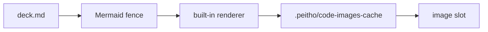
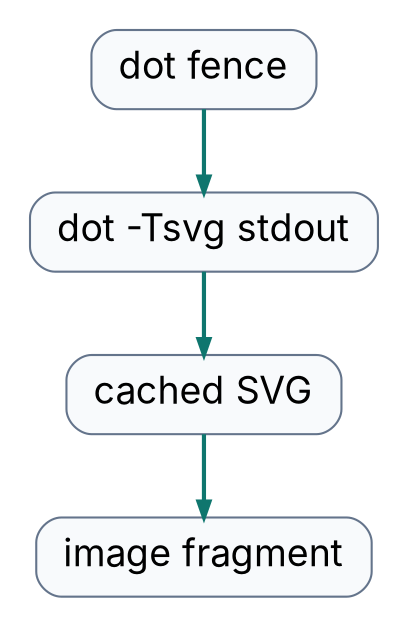
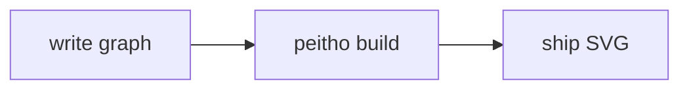

<!-- {"key":"mermaid-flow"} -->
# Mermaid is built in

Fenced `mermaid` source is rendered at build time without frontmatter. The SVG
lands in Peitho's code image cache, then enters the normal image pipeline.



---
<!-- {"key":"qrcode-link"} -->
# QR codes are built in

A `qrcode` fence whose trimmed text is one non-empty line becomes a fixed
black-on-white SVG with a standard quiet zone. It follows the same cache and
image-slot path as Mermaid.

```qrcode
https://peitho.gosu.ke/
```

---
<!-- {"key":"graphviz-flow"} -->
# Graphviz uses the same contract

The `dot` entry is just another user-declared command. Graphviz emits XML,
comments, and a DOCTYPE before `<svg>`; Peitho accepts that real-world SVG
preamble.



---
<!-- {"key":"before-after"} -->
# Before and after stay visible

The left pane is the same Mermaid graph shown as ordinary Markdown source.
The right pane is the matching fenced block after Peitho's built-in Mermaid
renderer turns it into an SVG image.

::: {slot=code}

````md

````

:::

::: {slot=image}


:::

---
<!-- {"key":"config-source"} -->
# The deck owns the commands

Mermaid and QR codes are built in. The deck declares commands for non-built-in
language tags, and each command receives the fenced source verbatim on stdin,
including its trailing newline. Explicit `code_images.mermaid` or
`code_images.qrcode` entries would override the corresponding built-in
renderer.

```yaml
---
layouts: ./layouts
css: ./css
code_images:
  dot: dot -Tsvg
---
```
